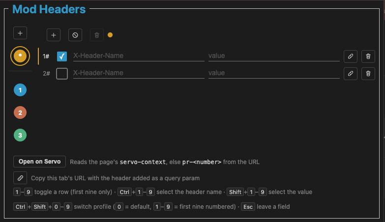
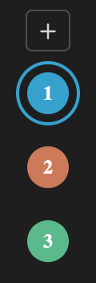
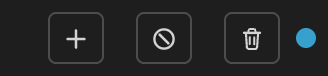
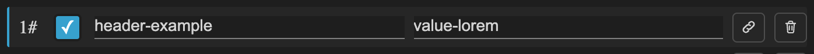

# FERHEADER



A small Chrome extension to add, edit, and toggle custom HTTP request headers, designed to be driven almost entirely from the keyboard. Headers are organized into independent **profiles** (e.g. one per project or environment), each with its own color, so you can keep several header sets ready and switch between them instantly.

## Installing (Load unpacked)

This extension isn't published on the Chrome Web Store, so it's installed via Developer Mode's "Load unpacked" option:

1. Download or clone this repository.
2. _(Only needed if you changed something under `src/`)_ run:
   ```
   npm install
   npm run build
   ```
   This compiles `src/*.ts` into `dist/background.js` and `dist/popup.js`. The repo already ships with `dist/` built, so this step is optional for normal use.
3. Open `chrome://extensions` in Chrome.
4. Turn on **Developer mode** (toggle in the top-right corner).
5. Click **Load unpacked**.
6. Select this repository's root folder — the one containing `manifest.json`.
7. FerHeader's icon appears in the toolbar. Click the puzzle-piece icon and pin it for one-click access.

The toolbar icon itself reflects whether anything is active: lit up when the active profile has at least one header turned on, dim when it doesn't.

| Active | Inactive |
| --- | --- |
|  |  |

## Features

### Profiles (left rail)



Each numbered circle is a profile — an independent collection of header rows with its own color. Only the active profile's checked headers are ever sent; switching profiles atomically clears the previous profile's headers and applies the new one's, so an inactive profile's checked rows never leak into your requests.

- **Add a profile** — the `+` button above the circles creates a new profile (starting with one empty row), makes it active immediately, and assigns it the next color in the palette.
- **Switch profiles** — click a circle, or use the keyboard shortcut below.
- **Delete the active profile** — use the trash button in the top bar (see below). The last remaining profile can't be deleted.

### Top bar



Shared across every profile, left to right:

- **Add header row (`+`)** — appends a new empty row to the active profile.
- **Activate/deactivate all (circle icon)** — toggles every row in the active profile on or off in one click. The icon swaps between a checkmark and a slash depending on the current state, and the button disables itself when the active profile has no rows.
- **Delete profile (trash)** — deletes the active profile.
- **Color swatch (dot)** — shows the active profile's color, matching its circle in the rail.

### Header rows



Each row defines one HTTP header:

- **Checkbox** — turns that single header on or off. Only rows that are checked *and* have both a name and a value actually get sent.
- **Name / Value fields** — the header name (e.g. `X-Header-Name`) and the value to send.
- **Copy-URL button (link icon)** — copies the current tab's URL with this header's name/value appended as a query parameter, handy for sharing a reproducible link.
- **Delete button (trash icon)** — removes the row immediately. No confirmation, no limit on how many rows a profile can have.

A checked row's left edge is tinted in the active profile's color, so it's clear at a glance which headers are live.

### Keyboard shortcuts

Also shown in the popup's footer:

| Shortcut | Action |
| --- | --- |
| `1`–`9` | Toggle row N on/off (first nine rows only) |
| `Ctrl`+`1`–`9` | Focus and select row N's header-name field |
| `Shift`+`1`–`9` | Focus and select row N's value field |
| `Ctrl`+`Shift`+`1`–`9` | Switch to profile N (first nine only) |
| `Esc` | Leave the focused field |

Plain digit shortcuts are ignored while typing in a text field; the modifier combos above work from anywhere, including while a field is focused.

### Open on Servo

A button that opens the current tab's corresponding Servo stack. It first looks for a `<meta name="servo-context" content="servo:...:region:app:stack">` tag on the page; if that's missing, it falls back to parsing a `pr-<number>` subdomain out of the tab's URL.

## Development

```
npm install
npm run build   # compiles src/*.ts into dist/*.js
```
